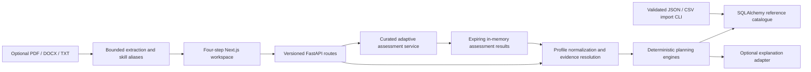

# Architecture

SHIFT//OS is a local, single-workspace career planning MVP. The browser runs Next.js, React and TypeScript; one FastAPI service owns all intelligence calculations; SQLAlchemy stores the public reference catalogue in SQLite. PostgreSQL can be configured through `DATABASE_URL`, but it has not been exercised in this environment.

## Data flow

The first step builds an evidence-aware profile. The same profile, selected occupation and scenario are sent to career, impact, roadmap, simulation and employer endpoints. The frontend renders the returned values; it does not duplicate career or employer scoring formulas. Updating a profile or assessment invalidates downstream results. Selecting a different occupation generates a different gap analysis, learning plan and projected role alignment.

`profile.occupation_id` is the target occupation when direction is `target`. `profile.current_occupation_id` is a professional's existing occupation. The selected pathway is also supplied as a top-level request `occupation_id`. Current-job task exposure can therefore remain administrative while the target roadmap concerns data analysis. For compatibility, professional explore-mode requests may use the original `profile.occupation_id` as their current occupation; new clients should use the explicit field.

## Code ownership

| Module | Responsibility |
| --- | --- |
| `backend/app/main.py` | REST routes, CORS, health, read-only diagnostic boundaries |
| `backend/app/schemas.py` | Bounded profile/request validation and typed public engine responses |
| `backend/app/engines.py` | Profile evidence, ranking, gaps, exposure, scenarios, roadmap, simulation, employer projection |
| `backend/app/assessment.py` | Server-held question bank, adaptive selection, objective grading, provisional estimation, session expiry |
| `backend/app/cv.py` | Document validation, temporary upload closure, text extraction and original skill phrases |
| `backend/app/llm.py` | Optional explanation wording; never authoritative scores or evidence |
| `backend/app/models.py` | SQLAlchemy relational tables, foreign keys and indexes |
| `backend/app/data.py` | Catalogue validation, transactional imports, database reads and safe connectivity checks |
| `frontend/src/lib/api.ts` | Shared typed request transport, timeouts and error recovery |
| `frontend/src/components/` | Personal profile, assessment, career results, roadmap, employers and System Insights |

The intelligence functions are independent from route handlers. The current implementation keeps related deterministic engines in one explicit module rather than creating a separate service or microservice for each formula.

## Persistence and provenance

The public catalogue has stable country, source, skill, occupation, task, course, employer-role, scenario and dataset identifiers. Relational occupation-skill, resource-skill and employer-requirement tables enforce mapping integrity. JSON payloads retain the original provenance and authoring metadata alongside normalized relationships. Sources distinguish source-backed links, curated illustrative assumptions, synthetic demonstrations and unavailable data.

The country registry covers all eleven requested ASEAN countries. Operational planning is deliberately gated to Malaysia in `require_market`; changing a country registry flag alone does not enable another market. Expansion requires local datasets, importer validation, engine routing and coverage tests together. No Malaysian statistics are silently substituted for another country.

Profiles are request-scoped and are not inserted into the application database. CVs are not retained; FastAPI may spool a multipart upload to temporary storage before the extraction handler closes it. Assessment results live for two hours in a single backend process and disappear on restart. Authored assessment questions and rubrics can be seeded into private database tables, but `get_catalog` and the public dataset explorer do not expose them. See [assessment methodology](assessment_methodology.md) for evidence ownership and expiry.

## Optional provider

The app works without `OPENAI_API_KEY`. When configured, only the career-score explanation inspector can ask the OpenAI Responses API for wording about a restricted calculation payload. It sends title, calculated factors, existing explanation, evidence status and market-data limitation; it sends no raw CV text, contact details, background narrative or education record. Derived factors still describe the calculation and should be included in a future privacy review.

The provider returns JSON validated with Pydantic. Unexpected source IDs, numerical claims and URLs cause a deterministic fallback. Network, response and validation errors also preserve the deterministic explanation. All scores, skill levels, course links and employer requirements originate in the deterministic code and catalogue. Response storage is disabled with `store: false`. The request shape follows [official OpenAI Structured Outputs guidance](https://developers.openai.com/api/docs/guides/structured-outputs?api-mode=responses) and the [Responses migration storage guidance](https://developers.openai.com/api/docs/guides/migrate-to-responses).

Tests cover the adapter using a fake provider. No paid live-provider call was performed, and free-form wording is not a scientifically validated interpretation.

## Deployment boundary

The intended demo runs one FastAPI worker and a Next.js server. SQLite foreign keys are enabled. CORS is restricted to configured local origins. Diagnostic endpoints expose the public catalogue and safe status, without environment secrets, raw uploads, private profiles or answer keys.

This is not an authenticated public service. Before a public pilot, add identity/session ownership, request and rate limits, a reverse-proxy upload cap before multipart parsing, durable evidence storage with deletion controls, migrations and operational monitoring. A safe code-execution sandbox is a separate future capability; this MVP never executes submitted Python or SQL. See [known limitations](limitations.md).
